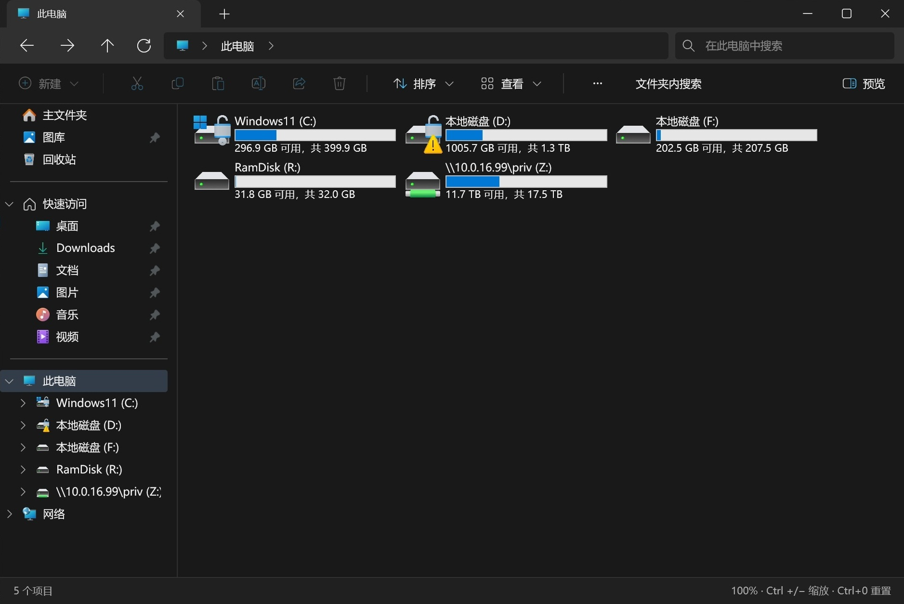

# Rust Explorer

[](https://github.com/Mingcodeingmiao/rust-explorer/actions/workflows/ci.yml)
[](LICENSE)

<p align="center"></p>

使用 **Rust + GPUI** 编写的 Windows 原生文件管理器，支持多标签、系统右键菜单、缩略图和预览，无需浏览器或 WebView2 运行时。

<p align="center"></p>

**当前版本为 0.7.7 part1。** 新增中英日韩语言下拉选择（默认英文）、SQLite 缩略图缓存及目录设置，修复快速连续双击进入目录，优化搜索结果路径展示，并区分根目录与子目录的共享菜单。详见 [part1 更新说明](docs/v0.7.7-part1.md)。

> [!WARNING]
> **Windows 原生右键菜单仍存在已知问题，尚未完全修复。** 部分 Windows 10 环境下文件菜单的深浅色或样式仍可能不一致；不同系统与 Shell 扩展的表现也可能不同。本次为阶段性更新，请勿视为菜单问题已全部解决。

最新已发布下载：[Rust Explorer 0.7.7 part1](https://github.com/Mingcodeingmiao/rust-explorer/releases/tag/v0.7.7-part1)。请完整解压 Windows x64 ZIP 并核对 `SHA256SUMS.txt`。升级前退出旧版；已启用文件夹关联时先恢复系统默认，再迁移并重新启用，参见[恢复说明](docs/default-folder-browser.md)。

[English](README.en.md) · [下载 Releases](https://github.com/Mingcodeingmiao/rust-explorer/releases) · [更新记录](CHANGELOG.md) · [已知边界](KNOWN_ISSUES.md)

## 功能

- 多标签、前进/后退/上级、面包屑地址栏与快捷键。
- 八种查看模式、列宽调整、排序、分组、筛选、框选与多选；可选高性能固定组件池模式，不支持大图标/中图标/超大图标/内容视图时自动回退传统实现。
- 系统快速访问同步、可调宽导航和预览窗格、驱动器容量页面；可浏览 MTP/便携设备（如 Android 手机）并通过 Shell 命名空间复制、删除项目，支持完整面包屑、左侧树展开、磁盘容量页和 MTP 项目右键菜单。
- 原生文件剪贴板、复制/移动/重命名/回收站操作，以及本程序事务的撤销/重做；拖放前确认。MTP 删除为永久删除；可移动设备删除前检测回收站是否可用。
- 真实 Windows Shell 完整菜单，保留系统提供的文件、目录、驱动器和背景菜单；文件夹菜单提供新标签页/新窗口打开，空白菜单提供粘贴。
- 图片、视频单帧、PDF、字体与文件夹缩略图，链接箭头和隐藏文件半透明。
- 明色/暗色/跟随系统主题、界面缩放和高 DPI 图标。
- 可选 Everything 搜索；不可用时明确回退到当前文件夹名称筛选。

缩略图与 Shell 扩展由后台队列或隔离 helper 处理，超时或不支持时回退普通图标。helper 不是安全沙箱。

## 下载与运行

从 [Releases](https://github.com/Mingcodeingmiao/rust-explorer/releases) 下载 Windows x64 ZIP，**完整解压**后运行 `rust-explorer.exe`，通常无需管理员权限。发行文件目前未签名，请比对同版本 `SHA256SUMS.txt`。

Everything 集成需要已安装、可用的 Everything 客户端。不接管 Win+E。默认文件夹浏览器（0.7.3 起）需在常规选项中主动试用，仅关联普通文件夹和驱动器，包含原值备份、120 秒试用保护和恢复入口，详见[使用与恢复说明](docs/default-folder-browser.md)。安装或启动不会自动开启关联。配置与图像缓存位于 `%LOCALAPPDATA%\RustExplorer`。

## 从源码构建

需要 Windows 10/11 x64、Rust stable（2024 edition）、Visual Studio C++ Build Tools 和 Windows SDK。推荐 MSVC；Release 需要 SDK 中的 `fxc.exe`，构建脚本会自动查找。

```powershell
git clone https://github.com/Mingcodeingmiao/rust-explorer.git
cd rust-explorer
# 可选：下载官方 Everything SDK，不安装或修改 Everything 客户端
.\scripts\bootstrap.ps1
.\scripts\build.ps1 -Release
.\dist\RustExplorer-windows-x64-native\rust-explorer.exe 'C:\'
```

Debug 构建省略 `-Release`。MSYS2 UCRT64 用户安装 `stable-x86_64-pc-windows-gnu` 后使用 `scripts/build.ps1 -Gnu -Release`，默认 GCC 路径为 `C:\msys64\ucrt64\bin`。GNU 运行库分发需另行检查上游许可。

## 检查与打包

```powershell
.\scripts\check.ps1
.\scripts\package.ps1
```

检查包括格式、无桌面 feature 的核心库测试，以及默认桌面 feature 的全部 target 编译检查。打包脚本打包最近构建结果，不会代替构建或测试。[GitHub Actions](.github/workflows/release.yml) 可手动构建 MSVC 发行产物。

涉及文件操作的测试请使用独立新建目录，不要对真实文件、驱动器或共享权限做破坏性验证。

## 文档与贡献

- [贡献指南](CONTRIBUTING.md)、[行为准则](CODE_OF_CONDUCT.md)、[安全报告](SECURITY.md)
- [快捷键](docs/explorer-shortcuts.md)、[架构](docs/architecture.md)、[撤销/重做](docs/file-history-062.md)
- [原生预览](docs/native-previews.md)、[系统图标](docs/system-icons.md)、[运行时资源](docs/fluent-icons.md)
- [0.7.7 更新说明](docs/v0.7.7.md)、[0.7.6 更新说明](docs/v0.7.6.md)、[0.7.5 更新说明](docs/v0.7.5.md)、[0.7.4 更新说明](docs/v0.7.4.md)、[0.7.3 更新说明](docs/v0.7.3.md)、[后续计划](ROADMAP.md)、[0.6.2 验证记录](docs/audit-0.6.2.md)

欢迎通过 Issue 模板报告可复现问题，提供版本、Windows build、DPI/缩放、主题和查看模式；上传前移除个人路径及敏感内容。

## 许可证与署名

[Apache-2.0](LICENSE)。第三方依赖保留各自许可，见 [NOTICE](NOTICE) 和 [THIRD_PARTY_NOTICES.md](THIRD_PARTY_NOTICES.md)。系统图标在运行时读取，缺失时使用附有许可的微软 Fluent SVG；仓库不分发提取的 Windows 图像或 DLL。应用品牌图标为原创 AI 辅助设计，保留[生成说明](resources/app-icon/README.md)。

项目独立开发，与 Microsoft 或 Rust Foundation 无隶属或背书关系。
